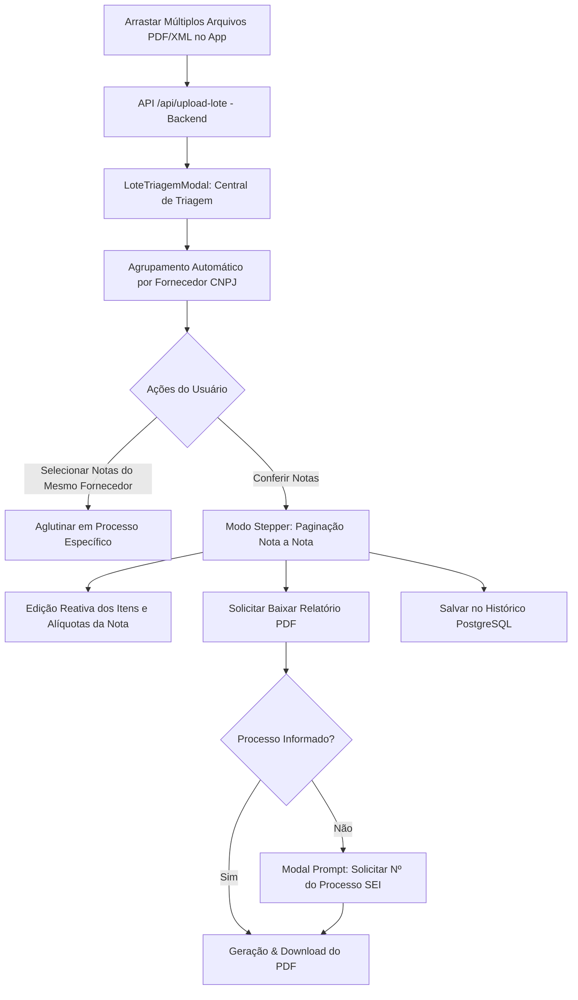

# Plano de Implementação — Rotina de Retenções em Lote com Análise Individual e Agrupamento por Fornecedor

## 1. Visão Geral e Problema a Resolver
Atualmente, o usuário necessita arrastar uma nota por vez caso queira realizar ajustes minuciosos (alíquotas, NCMs, itens, retenções de ISS/INSS) ou emitir o relatório individual de cada nota fiscal. Ao arrastar múltiplos arquivos simultâneos, o sistema consolidava tudo em um único modal geral, sem permitir ajustes finos por documento, nem distinguir processos ou aglutinar notas do mesmo fornecedor de forma customizada.

Este projeto implementa a **Opção A (Central de Triagem por Fornecedor com Paginação Nota a Nota)**:
1. **Arrasto em Massa:** O usuário pode arrastar dezenas de notas fiscais (PDFs e XMLs) de uma só vez.
2. **Triagem Automática por Fornecedor:** O sistema detecta os CNPJs e agrupa as notas recebidas por fornecedor.
3. **Aglutinação por Processo:** Dentro de cada fornecedor, o usuário pode selecionar quais notas pertencem ao mesmo processo e aglutiná-las em um lote consolidado de pagamento, ou manter notas avulsas.
4. **Navegação Paginada (Stepper) e Ajustes Individuais:** Permite navegar nota a nota com botões `[⬅ Anterior]` e `[Próxima ➡]`, visualizando e editando itens, alíquotas, ISS e INSS com recálculo reativo individualizado.
5. **Prompt Inteligente do Número do Processo (SEI):** No momento em que o usuário solicita o download do relatório (individual ou consolidado), o sistema valida se o processo já está informado; caso não esteja, abre um modal solicitando o número do processo formatado antes de iniciar a geração do PDF.
6. **Persistência no Banco de Dados:** Permite gravar individualmente a nota conferida ou salvar todo o lote no PostgreSQL.

---

## 2. Arquitetura da Solução

### 2.1 Componentes a Criar e Modificar

1. **`ModalPromptProcesso.tsx`** *(Novo Componente)*:
   - Diálogo focado e elegante para entrada/confirmação do Número do Processo (máscara automática SEI: `xxxxx.yyyyyy/aaaa-dd`) e Nota de Empenho opcional.
   - Disparado automaticamente antes de gerar PDFs se o processo não estiver preenchido.

2. **`LoteTriagemModal.tsx`** *(Novo Componente)*:
   - **Aba/Visão 1: Central de Triagem**:
     - Cards por Fornecedor (Razão Social, CNPJ, Regime Tributário Simples/Normal, Total Bruto, Total Retido).
     - Lista das notas fiscais daquele fornecedor com checkboxes para aglutinação.
     - Ação de "Aglutinar Selecionadas no Processo" ou "Desmembrar".
     - Ação de "Iniciar Conferência Paginada".
   - **Aba/Visão 2: Conferência Paginada (Stepper)**:
     - Barra de navegação superior com contador: `Nota X de Y` + `Seletor Rápido de Notas` + `[⬅ Anterior]` e `[Próxima ➡]`.
     - Indicador claro de status de conferência da nota (Conferida / Em Aberto).
     - Formulário e Relatório de Conferência completo da nota atual (reutilizando os componentes de edição de itens e alíquotas).
     - Botões dedicados: "Baixar Relatório Desta Nota", "Baixar Relatório Consolidado do Processo", "Salvar Nota no Banco".

3. **`App.tsx`** *(Modificação)*:
   - Integração do `handleFilesUpload` para alimentar o `LoteTriagemModal`.
   - Gerenciamento de estado do lote de notas em memória.

---

## 3. Plano de Execução Detalhado

- [x] **Etapa 1:** Elaborar e registrar este Plano de Implementação na pasta `calc_impostos/Formalidades/`.
- [ ] **Etapa 2:** Desenvolver o componente `ModalPromptProcesso.tsx` com máscara SEI e validação.
- [ ] **Etapa 3:** Desenvolver o componente `LoteTriagemModal.tsx` com agrupamento por fornecedor, seleção e aglutinação por processo, modo stepper de conferência e botões de exportação.
- [ ] **Etapa 4:** Conectar o `LoteTriagemModal` no fluxo de drag-and-drop e upload múltiplo do `App.tsx`.
- [ ] **Etapa 5:** Validar a compilação do TypeScript, recálculo de notas individuais, download de relatórios individuais e consolidados com prompt do processo.

---

## 4. Critérios de Aceite
1. O usuário pode arrastar múltiplos arquivos de fornecedores diferentes simultaneamente sem erro.
2. O sistema agrupa claramente as notas por Fornecedor.
3. É possível aglutinar notas do mesmo fornecedor sob um mesmo processo.
4. É possível paginar entre as notas do lote e alterar individualmente itens, NCM, alíquotas e retenções sem afetar as outras notas.
5. Ao solicitar o download do PDF sem processo informado, o sistema abre o modal solicitando o número do processo SEI e aplica-o ao documento gerado.
